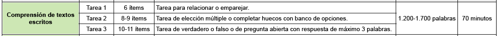

# 📖 CTE - Reading

## Estrategia de examen

!!! abstract "ESTRATEGIA"
      1. **Lectura rápida global** leer el texto completo en 1-2 minutos sin detenerse en palabras desconocidas, solo para entender de qué trata y cuál es su estructura (introducción, argumentos, conclusión).
      2. **Leer las preguntas antes de buscar respuestas** esto permite saber exactamente qué información hay que localizar, en lugar de releer el texto entero para cada pregunta.
      3. **Scan (búsqueda de información concreta)** una vez sabidas las preguntas, volver al texto buscando palabras clave, sinónimos o cifras relacionadas con cada pregunta, sin leer todo de nuevo. Buscar sinónimos, si la pregunta dice "disadvantage" y el texto dice "one of the main drawbacks", hay que reconocer que son sinónimos —los exámenes rara vez repiten la palabra exacta de la pregunta en el texto.
      4. **Comparar las opciones con la frase exacta del texto**, descartando las que añaden matices que el texto no dice (por ejemplo, si el texto habla de "reduced social contact" y una opción dice "makes people depressed", es una generalización no respaldada por el texto).
      5. **Check (verificación final):** releer solo la frase o el párrafo exacto donde está la respuesta para confirmar que encaja con lo que pide la pregunta, no solo con una palabra suelta que coincide por casualidad. Revisar las repuestas que no repitas palabras en las opciones de las tareas.

!!! note "Consejos: Trampas típicas de las preguntas de opción múltiple"
    1. **Distractor por palabra literal:** una opción repite una palabra del texto pero cambia el sentido de la frase. Leer siempre la frase completa, no solo buscar la palabra.
    2. **Distractor por negación:** el texto dice "not always" y la opción incorrecta dice "always" (o al revés). Prestar atención especial a negaciones, adverbios de frecuencia y matizadores (*mainly, partly, rarely*).
    3. **Distractor por generalización excesiva:** el texto menciona un caso concreto y la opción lo presenta como una regla general (o al revés).
    4. **Opción "casi correcta pero incompleta":** cubre parte de la idea del texto pero no toda, mientras que otra opción sí es completa.

## Audiolibros vocabulario
### The Adventures of Tom Sawyer
| Inglés | Español |
|---------|----------|
| therefore | por lo tanto / por consiguiente |
| belong | pertenecer |
| touched upon | mencionado brevemente / tratado de pasada |
| among | entre |
| west | oeste |
| shunned | evitado / rechazado |
| pleasantly | agradablemente |
| engaged | comprometido / ocupado / involucrado |
| gone | ido / desaparecido |
| wonder | preguntarse / maravilla |
| seldom | rara vez |
| through | a través de / por medio de |
| state pair | par de estados |
| fiercely | ferozmente / intensamente |
| furniture | muebles |
| lay | colocar / poner (en pasado de "lay") |
| get hold | conseguir / agarrar / hacerse con |
| bending down | agachándose |
| punching under | golpeando por debajo |
| broom | escoba |
| breath | respiración / aliento |
| punctuate | puntuar / marcar |
| resurrecter | resucitador *(término muy poco común; normalmente se usa "resurrector")* |
| beat | golpear / vencer |
| stood | estuvo de pie / se puso de pie |
| tomato vines | tomateras / enredaderas de tomate |
| weed | mala hierba / desherbar |
| lifted | levantó / levantado |
| angle | ángulo |
| slight | leve / ligero |
| seize | agarrar / apoderarse de |
| slack | flojo / holgura / aflojar |
| roundabout | rotonda / indirecto |
| arrest | arresto / detener |
| flight | vuelo |
| closet | armario |
| truck | camión |
| let | dejar / permitir / alquilar |
| skin | piel |
| switch | interruptor / cambiar |