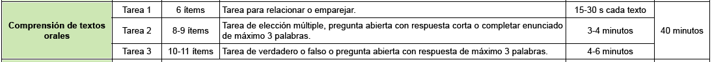

# 🎧 CTO - Listening 

## Estrategia de examen

| Tipo de tarea | En qué consiste | Consejo específico |
|---|---|---|
| Task 1| **1. Multiple matching** Relacionar varios hablantes con varias afirmaciones | Escuchar hasta el final antes de decidir: la respuesta correcta a veces se confirma solo al final del turno de cada hablante |
| Task 2 | **2. Note/sentence completion** Completar huecos con la palabra exacta que se oye  **2. Multiple choice**Elegir la opción correcta entre 3-4| - Prestar atención a la gramática del hueco (singular/plural, tiempo verbal) para no escribir una palabra que no encaja   - Las opciones incorrectas suelen mencionarse en el audio pero con una palabra que cambia el sentido (no, actually, but)|
| Task 3 | **3. True/False/Not mentioned** Decidir si una afirmación es verdadera, falsa o no aparece | No dar por falso algo que simplemente no se menciona: son categorías distintas |

!!! abstract "ESTRATEGIA"
      - **ANTES** de escuchar
          1. **Leer las preguntas con antelación**, durante el tiempo que se da antes de cada audio. Esto permite anticipar qué tipo de información hay que captar (un nombre, una cifra, una opinión) y "escuchar con un propósito" en lugar de escuchar pasivamente.
          2. **Subrayar palabras clave de las preguntas** (nombres, fechas, lugares) para reconocerlas rápidamente cuando aparezcan en el audio.
          3. **Predecir el contexto** a partir del título o la introducción de la tarea: ¿es una conversación informal, una entrevista, una noticia?
      - **DURANTE** la escucha
          1. **No bloquearse en una palabra que no se entiende.** Es preferible seguir escuchando y perder esa palabra que quedarse pensando en ella y perderse las tres frases siguientes.
          2. **Aprovechar la segunda escucha** (cuando la haya) para confirmar respuestas dudosas, no para escuchar todo desde cero sin criterio.
          3. **Tomar notas breves** (palabras sueltas, no frases completas) según se escucha, para no depender solo de la memoria.
              - Usar flechas para relaciones causa-efecto: **rain → traffic jam**
              - Abreviar palabras largas: **govt** (government), **info** (information), **approx** (approximately)
              - Anotar solo números, nombres propios y palabras clave, nunca frases completas.
              - Marcar con un signo de interrogación (**?**) las respuestas dudosas, para revisarlas en la segunda escucha en vez de perder tiempo decidiendo en el momento.

!!! note "CONSEJOS"
    1. **Practicar con material auténtico, no solo con exámenes de academia.** Noticias, podcasts, series con subtítulos en inglés, artículos de prensa británica o estadounidense.
    2. **No traducir mentalmente palabra por palabra.** Cuanto más se traduce internamente, más lento es el procesamiento y más se pierde por el camino. El objetivo es entender directamente en inglés.
    3. **Aceptar la ambigüedad tolerable.** No hace falta entender el 100% de las palabras para responder bien: el objetivo es entender lo suficiente para la tarea concreta.
    4. **Cronometrar siempre la práctica.** La gestión del tiempo en comprensión es tan entrenable como el propio idioma.
    5.  **Identificar los tipos de distractor** más habituales en preguntas de opción múltiple. (negaciones, generalizaciones y sinónimos parciales)
    6.  Leer preguntas antes de escuchar, tomar notas breves, aprovechar bien la segunda escucha.

!!! failure "ERRORES"
    1. **Dejar preguntas en blanco por quedarse "atascado" en una sola tarea difícil**, en lugar de seguir avanzando y volver después si queda tiempo.
    2. **Fiarse de la memoria en el listening sin tomar ninguna nota**, sobre todo en tareas con varios datos concretos (fechas, cifras, nombres).
    3. **Responder según conocimiento previo del tema en vez de según el texto/audio**, especialmente en preguntas tipo "According to the speaker...".
    4. **Ignorar la instrucción sobre el límite de palabras** en tareas de completar huecos, lo que puede anular una respuesta correcta por motivos de formato.

**ACENTOS**

Los audios pueden incluir **acentos no estándar**. Conviene practicar con fuentes variadas para no llevarse una sorpresa el día del examen.

| Acento/variedad | Dónde practicarlo |
|---|---|
| Británico estándar (RP) | BBC News, BBC Learning English |
| Británico regional (escocés, del norte de Inglaterra) | Series de la BBC ambientadas fuera de Londres |
| Americano general | NPR, podcasts de noticias de EE. UU. |
| Australiano/neozelandés | Podcasts de ABC Australia |
| Hablantes no nativos con acento marcado | TED Talks de ponentes de distintos países |

## Recursos

|  |  |
|---|---|
|[Test-English (Sección Listening B2)](https://test-english.com/listening/b2/){target="_blank"}|Tiene audios nivel B2 con preguntas de selección múltiple y verdadero/falso, y al terminar te explica por qué la opción correcta es esa y dónde estaba la trampa.|
|[Randall’s ESL Cyber Listening Lab](https://www.esl-lab.com/){target="_blank"} |Audios muy breves con cuestionarios inmediatos. Ideal para la Tarea 1 de la EOI.|
|[Exam English (EOI / FCE Listening B2)](https://www.examenglish.com/B2/B2_listening.htm){target="_blank"}|Prácticas específicas con el tipo de ejercicio de las escuelas de idiomas y Cambridge.|
| [BBC Learning English](https://www.bbc.co.uk/learningenglish){target="_blank"} | Podcasts, noticias y ejercicios de escucha con transcripciones |
| [VOA Learning English](https://learningenglish.voanews.com){target="_blank"} | Noticias en inglés simplificado con audio y texto |
| [Elllo](https://www.elllo.org){target="_blank"} | Más de 3000 escuchas con ejercicios interactivos y transcripciones |
| [TED-Ed](https://ed.ted.com){target="_blank"} | Vídeos educativos cortos con subtítulos en inglés |
| [EnglishClass101 (canal de YouTube)](https://www.youtube.com/@EnglishClass101){target="_blank"} | Lecciones de escucha por niveles en su canal gratuito de YouTube |
| [LyricsTraining](https://lyricstraining.com){target="_blank"} | Aprende inglés rellenando huecos en letras de canciones mientras escuchas, gratis |
| [Storyline Online](https://storylineonline.net){target="_blank"} | Actores leen en voz alta cuentos infantiles en inglés, gratis; muy útil para entrenar el oído desde niveles bajos |
| [BBC Sounds](https://www.bbc.co.uk/sounds){target="_blank"} | Radio y podcasts en inglés real de la BBC, gratis |
| [Manythings.org](https://www.manythings.org){target="_blank"} | Ejercicios y quizzes gratuitos de listening y vocabulario, muy usado por profesores de ESL |

## Listening BBC intermediate

| Inglés | Pronunciación (aprox. en español) | Significado | Ejemplo |
| --- | --- | --- | --- |
| **260813 Who does the housework?** | | | |
| **Chores** | chors | Tasks around the home, such as cleaning, washing and ironing, that have to be done regularly | I have to do my chores before I can go out. |
| **Fair share** | fer sher | Reasonable amount | Everyone should do their fair share of the housework. |
| **Women's work** | ui-mens uork | Negative term for the boring and repetitive tasks which are traditionally or stereotypically done by women | He still thinks cooking is women's work. |
| **Division of labour** | di-vi-zhon ov lei-bor | Way of organising work where different tasks are done by different groups of people | There should be a fair division of labour at home. |
| **Take a breather** | teik a brii-zer | *(idiom)* Stop what you are doing for a short time to rest | Let's take a breather before we finish the last task. |
| **Pull your weight** | pul yor ueit | Work as hard as everyone else doing the same job | You need to pull your weight if we're doing this together. |
| **260806 How do climate scientists make predictions?** | |  | |
| **Prediction** | pri-dík-shon | Statement about what you think will happen in the future | Climate scientists made a prediction about rising sea levels. |
| **Conditional** | kon-dí-sho-nal | Depending on other factors; not certain | The forecast is conditional on future emissions levels. |
| **The thing about…** | de zing a-báut | *(informal)* Used to introduce the most important feature or detail to understand about something | The thing about climate models is that they rely on assumptions. |
| **Out of whack** | aut ov uák | *(idiom)* Out of balance; not working properly or broken | The whole weather pattern is out of whack this year. |
| **Pro- (something)** | prou | In favour of (something) | She is very pro-renewable energy. |
| **(Not) on the table** | (not) on de téi-bol | *(idiom)* (Not) considered an option or a possibility | A carbon tax is now on the table. |
| **260730 The Enhanced Games**  | | | |
| **Doping** | dóu-ping | *(informal)* Using banned substances to perform better in a sports competition | The athlete was banned for doping. |
| **It's fair to say…** | its fer tu sei | Used to introduce a statement which the speaker believes is balanced, reasonable or true | It's fair to say the event was a success. |
| **Divisive** | di-vái-siv | Causing disagreement and argument between people | The new policy proved to be very divisive. |
| **Cross the line** | kros de lain | Start behaving in an unacceptable way | He crossed the line when he insulted the referee. |
| **Set a good/bad example** | set a gud/bad ig-zám-pol | Behave in a way that encourages others to behave well/badly | Coaches should set a good example for young athletes. |
| **Normalise** | nór-ma-laiz | Treat something as normal or acceptable when it previously was not | The documentary shows how doping became normalised in the sport. |
| **260723 Children in warzones** | | | |
| **Hyper-vigilant** | jái-per ví-yi-lant | Be very careful or almost too careful to notice things, particularly when there is a possibility of danger | Children in warzones often become hyper-vigilant about sudden noises. |
| **Be of one mind** | bi ov uán maind | Be part of a group of people that share the same opinion, desire, or viewpoint on a matter | The teachers were of one mind about how to support the children. |
| **Confront** | kon-frónt | Meet with it or deal with something | Many children have to confront experiences no adult should face. |
| **Nightmare** | náit-mer | A scary or upsetting dream | She still has nightmares about the bombing. |
| **Phenomenally** | fi-nó-me-na-li | Do something in an extreme or surprising way | The children adapted phenomenally well given the circumstances. |
| **Resilient** | ri-síl-ient | Able to recover and come back from something difficult or bad | Children can be remarkably resilient after traumatic experiences. |