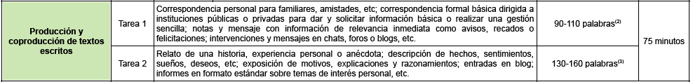
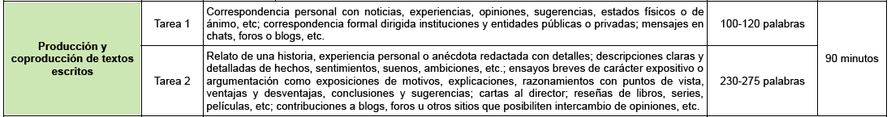

# ✍️ PCTE - Writing

| 🟢 B1 | 🔵 B2 |
|---|---|
|  |  |

Escribir bien en el examen no es solo "no cometer errores": es **responder exactamente a lo que pide la tarea**, con la estructura, el registro y la extensión adecuados, usando un lenguaje variado y bien conectado. 

!!! question estructura "Estructura"

    | Paso | Qué hacer |
    |------|-----------|
    | **1. Leer y subrayar** | Lee el enunciado **dos veces** y subraya:  1. **Tipo de texto** (email, blog, essay...) 2. **Destinatario/registro** (amigo = informal, revista/empresa = formal) 3. **Puntos obligatorios** (busca viñetas o negrita, normalmente 2) 4. **Número de palabras** 5. **Propósito** (informar, quejarse, opinar, recomendar…) |
    | **2. Planificar** | Dedica **3-5 minutos**: escribir sin plan es la causa nº 1 de textos desordenados, repetitivos o sin conclusión. Antes de escribir, ordena mentalmente (o en un borrador rápido) qué pasó primero, segundo, tercero... [4 párrafos]  **TASK 1:** (Temas cotidianos: viajes, salud, trabajo, tecnología, hábitos.) 1. Anota los puntos obligatorios, con 1-2 frases clave. 2. Asigna una estructura gramatical objetivo a cada frase:  *present perfect · past perfect · conditional · passive voice · relative clause · comparativo doble · cleft sentence · inversión · wish* 3. Usa conectores de tiempo para guiar al lector ("no los de siempre"). **TASK 2:** (Temas sociales/abstractos: redes sociales, publicidad, medio ambiente, educación, trabajo remoto.)  Lo mismo, pero por párrafo en vez de por frase: intro, cuerpo 1, cuerpo 2 y conclusión, con una estructura objetivo por párrafo. |
    | **3. Redactar** | Sigue el esquema y controla el tiempo restante para no quedarte sin terminar la conclusión. 🔢 **Regla de las 10 palabras:** redondeando, cada frase tiene unas **10 palabras**. Si te piden **100 palabras → 10 frases**. |
    | **4. Revisar** | Reserva **3-5 minutos** al final. 1. **Concordancia verbal:** el tiempo verbal debe ser coherente. Si hablas de unas vacaciones pasadas, no puede haber estructuras en presente. 2. **Ortografía:** con la prisa es fácil escribir mal una palabra, y eso puede cambiar el significado. 3. **Conectores:** ten claros los tipos que hay y comprueba que encajan donde los has colocado. 4. **Características:** se cumple el número de palabras (±10% es un margen razonable), el tipo de texto, el registro y los puntos obligatorios. |

## ✉️ Email

!!! success estructura "Estructura · email informal (~100 palabras)"

    1. **Greeting** — saludo + coma, y línea nueva: *Hi Sandy,* / *Dear John,*
    2. **Opening** (párrafo 1) — reacciona a su e-mail y pregunta cómo está.
    3. **Main 1, 2, 3** — un párrafo por cada nota de la tarea; justifica cada respuesta con *because* / *so*.
    4. **Closing** — empieza a despedirte y pide respuesta.
    5. **Farewell + name** — despedida con coma y tu nombre en otra línea, sin punto: *Take care,* / *Luis*

!!! quote frases "💬 Frases clave para memorizar"

    | Parte | Frases |
    |-------|--------|
    | **Greeting** | *Hi Sandy,* |
    | **Opening** | 1. *It's so good to read your email!* 2. *I'm really (great / sorry) to read your news.* 3. *Hope you're doing well. How are things going?* |
    | **Main 1, 2, 3** | 1. *I'd prefer to relax at home* ***because*** *I'll probably be tired after the trip.* 2. ***As for*** *climbing, I'm afraid I can't* ***because*** *I hurt my knee last week.* 3. ***How about*** *visiting some art galleries? What do you think?* |
    | **Closing** | 1. *I really hope to hear from you soon.* 2. ***Anyway,*** *I have to go now,* ***but*** *please let me know what you think.* 3. *I'm looking forward to hearing from you.* |
    | **Farewell + name** | 1. *Take care,* 2. *Lots of love,* 3. *Best wishes, / See you soon,* |

!!! tip consejos "💡 5 consejos"

    1. **Usa TODAS las notas:** subráyalas y táchalas al usarlas. Cada nota = un párrafo con su motivo (*because* / *so*).
    2. **Registro informal:** contracciones (*I'm, can't, I'll*), frases cortas, preguntas directas y alguna exclamación. Evita *Dear Sir/Madam*, *Yours faithfully*, *Nevertheless* y abreviaturas tipo *LOL, b/c*.
    3. **Fórmulas para opinar, rechazar y proponer:** *I'd like to / I'd prefer to* + infinitivo · *I'm afraid I can't…* · *How about* + -ing? / *We could…* / *Shall we…?*
    4. **Tiempos verbales:** present perfect para novedades (*I've just finished…*), past simple con *last week*, y *will / going to* para planes (*I'm going to arrive on Friday*).
    5. **Forma:** coma tras el saludo, la despedida y el conector al empezar frase (*However, … / As for climbing, …*). Párrafos separados por una línea en blanco, que parezca un e-mail real.

### Informal vs formal

| Parte | 😊 Informal (amigo o familiar) | 👔 Formal (empresa, institución o desconocido) |
|---|---|---|
| **Saludo** | *Hi Anna,* / *Dear John,* | *Dear Sir or Madam,* / *Dear Mr Smith,* |
| **Apertura** | *How are you? Thanks for your last email.* *I hope you're doing well.* | *I am writing to enquire about…* *I am writing with regard to…* |
| **Cuerpo** (1-2 párrafos) | Lenguaje coloquial, contracciones (*I'm, don't, can't*), frases cortas | Sin contracciones, vocabulario preciso, tono neutro y respetuoso |
| **Cierre** | *Write back soon!* *Can't wait to hear from you.* | *I look forward to hearing from you.* *Please do not hesitate to contact me.* |
| **Despedida** | *Best,* / *Take care,* / *Love,* | *Yours faithfully,* (si no sabes su nombre) *Yours sincerely,* (si sabes su nombre) |

> **Error típico:** mezclar registro formal e informal en el mismo texto (empezar con "Dear Sir/Madam" y despedirse con "Bye!"). El registro debe ser coherente de principio a fin.

**Por nivel:** en B2 se espera cierta elaboración argumentativa (quejas, sugerencias); en C1 se valora la precisión del registro y el uso de fórmulas menos comunes (**I would be most grateful if**..., **Should you require further information**...).

## 📝 Blog entry

!!! success estructura "Estructura · blog entry (~100–125 palabras)"

    1. **Information** — user · date/time · **catchy title**: una pregunta o una idea corta que resuma la entrada (ej: *"An Unplanned Adventure in Scotland"*).
    2. **Introduction** (párrafo 1) — engancha al lector y di por qué escribes **(1-2 frases)**.
    3. **Main part 1** (párrafo 2) — tu experiencia o primera idea, con un ejemplo.
    4. **Main part 2** (párrafo 3) — el otro lado o una segunda idea, y su consecuencia.
    5. **Ending** — resume y termina con una **pregunta** o llamada a la acción para que el lector comente: *"Have you ever had a trip that didn't go as planned? Share your story in the comments!"*

!!! quote frases "💬 Frases clave para memorizar"

    | Parte | Frases |
    |-------|--------|
    | **Information** | 1. Catchy title + on date  2. *Is online learning better than face-to-face classes?* 3. *Posted by LanguageLover on 10 November 2026, 18:30* |
    | **Introduction** | 1. **Catching attention:** *Have you ever…? (¿Alguna vez has... ?* 2. **Catching attention:** *The reason I am writing this is…* 3. **Catching attention:** *Can you imagine…?* |
    | **Main part 1** | 1. **Starting the main part:** *Firstly / To start with, …* 2. **Expressing an opinion:** *I'd like to share my experiences / thoughts with you.* 3. **Giving examples:** *For example / For instance, …* |
    | **Main part 2** | 1. **Adding more information:** *Secondly / Apart from that / In addition, …* 2. **Expressing an opinion:** *In my opinion / To my mind, I am convinced that…* 3. **Giving explanations:** *That's why / So / Therefore …* |
    | **Ending** | 1. **Summing up / Concluding:** *All in all / To sum up, I think…* 2. **Inviting comments:** *What do you think about this?* 3. **Inviting comments:** *Share your thoughts! / Let me know what you think…* |

!!! tip consejos "💡 5 consejos"

    1. **Tono cercano:** primera persona, contracciones (*I'm, don't*), háblale al lector (*you*) y alguna exclamación, sin pasarte.
    2. **Pregunta al lector solo dos veces:** una al principio para enganchar y otra al final para que comente. Sin título y sin cierre con pregunta pierdes puntos en *adecuación a la tarea*.
    3. **Varía la opinión:** no repitas *I think*; usa *To my mind, I'm convinced that, As far as I'm concerned*.
    4. **Gramática de la unidad:** comparativos (*more flexible than*), superlativos (*the best option*), *-ed/-ing* (*I felt bored / it was boring*). Si narras, mantén el pasado (*have → had, feel → felt*).
    5. **Conecta y separa:** al menos 3 conectores distintos (*However, In addition, For example, That's why, So*) y párrafos separados: intro · 1–2 de desarrollo · final.

## 💭 Essay de opinión

!!! success estructura "Estructura · opinion essay / composition"

    1. **Title** — corto, directo, relacionado con el tema (no una frase completa).
    2. **Introduction** (párrafo 1) — presenta el tema de forma general **parafraseando el enunciado, no copiándolo**, y anuncia los puntos que vas a tratar.
    3. **Main part 1** (párrafo 2) — argumentos a favor (o ventajas), cada uno con un ejemplo concreto.
    4. **Main part 2** (párrafo 3) — argumentos en contra (o desventajas / un matiz distinto), con su propio ejemplo.
    5. **Conclusion** (párrafo 4) — tu opinión personal clara, sin repetir literalmente lo ya dicho, y una reflexión final o recomendación.

!!! quote frases "💬 Frases clave para memorizar"

    | Parte | Frases |
    |-------|--------|
    | **Title** | 1. *Online Work or Personal Life?* 2. *Social Media: Friend or Enemy?* 3. *The Pros and Cons of Remote Work* |
    | **Introduction** | 1. ***Nowadays,*** *it is often said that…* 2. *One of the most debated issues today is…* 3. *In this essay, I will discuss both perspectives before giving my own opinion.* |
    | **Main part 1** | 1. ***Firstly,*** *one of the main advantages is that…* 2. *A strong argument in favour of this is…* ***For instance,*** *…* 3. ***Moreover / What is more,*** *…* |
    | **Main part 2** | 1. ***On the other hand,*** *some people believe that…* 2. ***However,*** *it could be argued that…* 3. ***Not only does it…, but it also…*** |
    | **Conclusion** | 1. ***In conclusion / All things considered,*** *I believe that…* 2. ***In my view / As far as I am concerned,*** *…* 3. *The best solution would be to…* |

!!! tip consejos "💡 5 consejos"

    1. **Registro semi-formal** (revista de opinión): primera persona permitida porque es tu opinión, pocas contracciones y nada de coloquialismos ni jerga.
    2. **Parafrasea el enunciado en la intro**, no lo copies, y guarda tu opinión clara y firme para la conclusión.
    3. **Contraargumenta:** en B2 se espera reconocer el punto de vista contrario antes de rebatirlo; en C1 se valora una postura matizada, no binaria: *While it is true that…, it is also important to consider…*
    4. **Conectores de organización y contraste:** *Firstly, Secondly, Moreover, However, On the other hand, Therefore*. Revisa el [esquema de conectores](#conectores-cat-6).
    5. **Luce estructuras B2, una por párrafo:** comparativo doble (*The more…, the…*), inversión (*Not only do we…*), condicional (*If I had…, I would…*), pasiva o relativas.

!!! example "*"Some people think social media has more disadvantages than advantages. Discuss both views and give your opinion." (150-200 words)*"
      Nowadays, social media platforms are part of almost everyone's daily routine. **(introducción parafraseando el tema, sin copiar el título literalmente)** While some people argue that they cause more harm than good, others believe their benefits outweigh the risks. In this essay, I will discuss both perspectives before giving my own opinion.
      
      On the one hand, social media can have a negative impact on mental health. **(conector de contraste + idea 1)** Constant exposure to curated images of other people's lives, for instance, often leads to feelings of inadequacy and anxiety. **(ejemplificación con "for instance")** Furthermore, the amount of time spent online can reduce face-to-face interaction with family and friends. **(conector de adición)**
      
      On the other hand, social media also offers clear advantages. **(conector de contraste + idea 2)** It allows people to stay connected with relatives who live far away, and it has become an essential tool for small businesses to reach new customers. **(dos argumentos concretos, no vagos)**
      
      In my view, the key issue is not social media itself, but how it is used. **(matiz, no postura binaria — típico de B2 alto)** Used in moderation, it can be a valuable tool rather than a source of harm.

**Por qué funciona:** responde exactamente a lo pedido (discutir ambas posturas + opinión propia), usa conectores variados, incluye ejemplos concretos en lugar de generalidades, y cierra con un matiz personal en vez de una conclusión genérica repetida.

## 🎬 Reseña (review)

Combina descripción objetiva y opinión personal sobre un libro, película, serie, restaurante, producto o evento.

!!! success estructura "Estructura · review"

    1. **Título** — el nombre de lo que reseñas o un titular llamativo.
    2. **Introducción** — qué se reseña (título, tipo, contexto: dónde y cuándo).
    3. **Descripción** — los aspectos principales (trama, ambiente, calidad, precio…), sin destripar el final.
    4. **Valoración personal** — puntos fuertes y débiles con argumentos concretos, no solo *I liked it*.
    5. **Recomendación final** — ¿a quién le gustaría y por qué?

!!! quote frases "💬 Frases clave para memorizar"

    | Parte | Frases |
    |-------|--------|
    | **Introducción** | 1. *I recently watched / read / visited…* 2. *It is set in… and tells the story of…* 3. *If you are looking for…, keep reading.* |
    | **Descripción** | 1. *The plot revolves around…* 2. *The atmosphere is relaxed / lively / cosy.* 3. *The highlight of the evening was…* |
    | **Valoración** | 1. *What struck me most was…* 2. *The only drawback is that…* 3. *Overall, it falls short of expectations because…* |
    | **Recomendación** | 1. *I would highly recommend it to anyone who…* 2. *It is well worth seeing / visiting.* 3. *I wouldn't recommend it to…* |

!!! tip consejos "💡 5 consejos"

    1. **Equilibra descripción y opinión:** no cuentes toda la trama; al menos la mitad del texto debe ser valoración.
    2. **Adjetivos precisos y variados** en lugar de *good / bad / nice*: *gripping, moving, breathtaking, overrated, disappointing*.
    3. **Tiempos verbales:** presente para contar la trama (*The film tells…*) y pasado para tu experiencia (*I went there last week…*).
    4. **Registro neutro o semi-formal** según dónde se publique (revista, web, blog del centro), dirigiéndote al lector.
    5. **Cierra siempre con una recomendación clara** que diga a quién va dirigida.

## 📊 Informe (report)

Un informe se diferencia claramente de un ensayo en el formato: usa **títulos y subtítulos**, no un texto corrido, y un tono objetivo, casi siempre en tercera persona o en voz pasiva.

!!! success estructura "Estructura · report"

    1. **Título y datos** — un título claro y, si procede, *To: … / From: … / Subject: …*
    2. **Introduction** — propósito del informe y a quién va dirigido.
    3. **Findings / Current situation** — datos y observaciones, organizados por subtítulos temáticos.
    4. **Recommendations** — sugerencias concretas y accionables, normalmente en forma de lista.
    5. **Conclusion** — resumen breve de la recomendación principal.

!!! quote frases "💬 Frases clave para memorizar"

    | Parte | Frases |
    |-------|--------|
    | **Introduction** | 1. *The aim of this report is to…* 2. *This report is based on a survey / interviews with…* 3. *It is intended for…* |
    | **Findings** | 1. *Findings show that…* 2. *According to the survey, most students…* 3. *It was found that…* |
    | **Recommendations** | 1. *It is recommended that…* 2. *It would be advisable to…* 3. *The school should consider…* |
    | **Conclusion** | 1. *Overall, it would be advisable to…* 2. *To sum up, …* 3. *If these measures are taken, …* |

!!! tip consejos "💡 5 consejos"

    1. **Usa subtítulos para cada sección:** escribir un informe como si fuera un ensayo, sin estructura visual, penaliza directamente en *adecuación a la tarea*.
    2. **Tono objetivo e impersonal:** tercera persona y pasiva (*It was found that…, It is suggested that…*); evita *I think*.
    3. **Registro formal:** sin contracciones ni expresiones coloquiales.
    4. **Recomendaciones concretas y accionables**, mejor en lista.
    5. **Apoya los hallazgos con datos o ejemplos** (*most / a few / the majority of…*), sin inventar cifras exageradas.

## 📣 Complaint letter

**Carta de reclamación**, muy habitual en B2 y C1. Combina el formato de carta formal con un tono firme pero educado, nunca agresivo.

!!! success estructura "Estructura · complaint letter"

    1. **Saludo** — *Dear Sir or Madam,* (si no sabes el nombre) / *Dear Mr Smith,*. Nada de *Hi* ni *Good morning*.
    2. **Introducción** (párrafo 1) — qué pasó y por qué escribes, con hechos concretos (fechas, productos, servicios) **(1-2 frases)**.
    3. **El problema** (párrafo 2) — detállalo con precisión, sin exagerar ni victimizarte.
    4. **La solución** (párrafo 3) — qué esperas que hagan (reembolso, sustitución, disculpa); usa condicional: *if you don't…, I will…*
    5. **Cierre y despedida** (párrafo 4) — fórmula que deje claro que esperas respuesta en un plazo razonable + despedida y nombre completo.

!!! quote frases "💬 Frases clave para memorizar"

    | Parte | Frases |
    |-------|--------|
    | **Introducción** | 1. *I am writing to complain about…* 2. *I am writing to express my dissatisfaction with…* 3. *I am writing regarding an order I placed on…* |
    | **El problema** | 1. *I am extremely disappointed with…* 2. *This is not what I expected.* 3. *To make matters worse, …* |
    | **La solución** | 1. *I would like a replacement / a full refund.* 2. *I trust you will resolve this matter promptly.* 3. *If you don't…, I will be forced to…* |
    | **Cierre y despedida** | 1. *I look forward to your reply / response.* 2. *Please do not hesitate to contact me.* 3. *Yours faithfully, / Yours sincerely,* |

!!! tip consejos "💡 5 consejos"

    1. **Registro formal en todo el texto:** nada de contracciones (*don't → do not*), ni *Hi*, ni *Bye*.
    2. **Firme pero educado:** un tono agresivo o coloquial (*This is ridiculous!!!*) penaliza en registro aunque el contenido sea correcto.
    3. **Hechos concretos:** fechas, número de pedido, producto y qué ocurrió exactamente.
    4. **Pide una solución clara y realista** (reembolso, sustitución, disculpa).
    5. **Despedida coherente con el saludo:** *Dear Sir or Madam → Yours faithfully*; *Dear Mr Smith → Yours sincerely*.

## 🎯 Rúbrica, consejos y errores

!!! abstract "Rubricas B2"
      1. **COMPETENCIA LÉXICA**
         1. Utiliza un vocabulario amplio y evita la repetición mediante reformulaciones.
         2. Su precisión léxica es generalmente alta, aunque tenga alguna confusión o cometa alguna incorrección al seleccionar las palabras, sin que afecte a la comunicación.
      2. **COMPETENCIA GRAMATICAL**
         1. Utiliza diversas estructuras simples, con un alto grado de control, y algunas estructuras más complejas.
         2. Comete errores solo al utilizar estructuras más complejas, pero sin que afecte a la comunicación.
      3. **COMPETENCIA DISCURSIVA Y ORGANIZATA**
         1. Produce un texto organizado y coherente usando diversos mecanismos de cohesión.
         2. Puntúa y usa la ortografía de manera correcta, aunque puede evidenciarse cierta influencia de otra lenguas. En textos largos, distribuye las ideas en párrafos lógicos y claros.
      4. **ADECUACIÓN DE LA TAREA**
         1. Se expresa con educación y elige el registro adecuado. Para ello utiliza expresiones lingüísticas apropiadas para el contexto. Se ajusta a la tipología textual propuesta.
         2. Desarrolla las ideas principales con detalle y de manera inteligible, aportando contenido relevante y ejemplificando, si es necesario, para la tarea propuesta.

!!! note "CONSEJOS"
      1. En la fase de planificación, **elegir de antemano** 4-5 conectores distintos que se van a usar en el texto, para forzarse a variar en lugar de caer siempre en los mismos por defecto bajo presión de tiempo.
      2. Escribir muy por debajo del mínimo penaliza por "desarrollo insuficiente del contenido"; escribir muy por encima del máximo penaliza por "falta de concisión" y, en exámenes con tiempo limitado, resta minutos a la revisión final. **Practicar el cálculo** aproximado de palabras a ojo (contando líneas y palabras medias por línea) ayuda a no tener que contar palabra por palabra en el examen.

!!! question "PREGUNTAS"
      1. **¿Puedo usar contracciones (I'm, don't) en un texto formal?**
      No. En textos formales se evitan las contracciones; en informales son recomendables porque dan naturalidad.
      2. **¿Cuenta el título como parte de las palabras del texto?**
      Depende de la convocatoria, pero por precaución conviene no incluir un título largo y centrar el recuento en el cuerpo del texto, siguiendo el formato exacto que pida el enunciado.
      3. **¿Está permitido tachar y corregir a mano si el examen es en papel?**
      Sí, tachar de forma clara y ordenada es preferible a dejar un error sin corregir; los correctores valoran la legibilidad, no la ausencia total de tachones.
      4. **¿Qué hago si me quedo sin tiempo para terminar la conclusión?**
      Siempre es mejor una conclusión de una frase, aunque breve, que dejar el texto sin cerrar: un texto sin conclusión se penaliza claramente en el criterio de adecuación a la tarea.

!!! failure "ERRORES"
      1. **No responder a todos los puntos del enunciado.** Si la tarea pide tratar tres aspectos y solo se desarrollan dos, se penaliza en "adecuación a la tarea" aunque el inglés sea impecable.
      2. **Registro inconsistente** dentro del mismo texto (mezclar formal e informal).
      3. **Repetir las mismas palabras y conectores** una y otra vez en lugar de variar el vocabulario.
      4. **Errores sistemáticos de concordancia** (sujeto-verbo, singular-plural) que se repiten varias veces en el texto.
      5. **No dejar tiempo para revisar.** Muchos errores tontos (falta de -s, mayúsculas olvidadas, errores de ortografía básicos) se detectan solo con una relectura atenta.

## Conectores cat-6

Elige la categoría según lo que quieres hacer. En cada una, arriba tienes la regla de **qué va detrás** y debajo los conectores imprescindibles.

=== "Contraste"

    **Detrás va:** frase nueva con punto (*however, on the other hand*) · sujeto + verbo (*although, whereas*) · solo nombre o -ing (*despite, in spite of*)

    | Conector | Significado | Ejemplo |
    |---|---|---|
    | **however** | sin embargo | It was expensive. However, it was worth it. |
    | **although** | aunque | Although it was raining, we went out. |
    | **despite / in spite of** | a pesar de | Despite the rain, they played the match. |
    | **whereas** | mientras que | She loves the city, whereas he prefers the countryside. |
    | **on the other hand** | por otro lado | It's fast. On the other hand, it's unreliable. |

=== "Causa"

    **Detrás va:** sujeto + verbo (*because, since, as*) · solo nombre (*due to, owing to, because of*)

    | Conector | Significado | Ejemplo |
    |---|---|---|
    | **because** | porque | We stayed in because it was raining. |
    | **since / as** | ya que | Since it was late, we decided to leave. |
    | **due to / owing to** | debido a | The flight was delayed due to bad weather. |

=== "Consecuencia"

    **Registro:** informal → *so* · formal → *therefore, as a result, consequently* (al principio de frase y con coma)

    | Conector | Significado | Ejemplo |
    |---|---|---|
    | **so** | así que | It was raining, so we stayed in. |
    | **therefore** | por lo tanto | She missed the train. Therefore, she was late. |
    | **as a result** | como resultado | He didn't study. As a result, he failed the exam. |
    | **consequently** | en consecuencia | The road was icy. Consequently, many accidents occurred. |

=== "Adición"

    **Registro:** formal → *moreover, furthermore* · neutro → *in addition, besides* · énfasis → *not only… but also*

    | Conector | Significado | Ejemplo |
    |---|---|---|
    | **moreover** | es más | It's cheaper. Moreover, it's more efficient. |
    | **furthermore** | además | Furthermore, the staff were excellent. |
    | **in addition** | además | In addition to the salary, there are great benefits. |
    | **not only… but also** | no solo… sino también | Not only is it fast, but it is also reliable. |

=== "Ejemplos"

    **Dónde:** dentro de la frase → *such as* · frase nueva → *for example, for instance*

    | Conector | Significado | Ejemplo |
    |---|---|---|
    | **for example** | por ejemplo | Many factors affect health. For example, diet and sleep. |
    | **for instance** | por ejemplo | Some sports, for instance football, are very popular. |
    | **such as** | como | Soft skills such as communication are essential. |
    | **in particular** | en particular | I enjoy travelling, in particular in Europe. |

=== "Orden"

    **Secuencia:** primero → segundo → último → cerrar

    | Conector | Significado | Ejemplo |
    |---|---|---|
    | **firstly / to begin with** | en primer lugar | Firstly, consider the cost. |
    | **secondly** | en segundo lugar | Secondly, think about the time. |
    | **finally** | por último | Finally, we reviewed the results. |
    | **in conclusion / to sum up** | en conclusión | To sum up, the results were positive. |

??? note "Ver todos los conectores (tabla completa y esquema)"

    **Resumen rápido por función**

    | Función | Conectores | Ejemplo |
    |---|---|---|
    | Añadir | **moreover, furthermore, in addition, besides** | The hotel was expensive. Moreover, the service was poor. |
    | Contrastar | **however, although, whereas, despite, nevertheless** | Although it was raining, we went out. |
    | Causa | **since, as, due to, owing to** | The flight was delayed due to bad weather. |
    | Consecuencia | **therefore, as a result, consequently** | She missed the train. As a result, she was late. |
    | Ejemplificar | **for instance, such as, namely** | Some sports, such as football, are very popular. |
    | Secuenciar | **firstly, subsequently, eventually, finally** | Firstly, we need to assess the situation. |
    | Concluir | **in conclusion, to sum up, overall, all in all** | To sum up, the benefits outweigh the drawbacks. |

    **Tabla completa**

    | Conectores | Uso | Ejemplo |
    |---|---|---|
    | **CONTRASTE Y CONCESIÓN**{:.yerbold} |*Muestran una oposición o un cambio de dirección respecto a la idea anterior* |*(Estructura lógica: Idea A ➔ Giro inesperado / Idea B contraria)* |
    | however / sin embargo | Une dos oraciones independientes; suele ir seguido de coma | It was expensive. However, it was worth it. |
    | nevertheless / no obstante, aun así | Concesión formal; introduce contraste manteniendo la idea principal | The plan had flaws. Nevertheless, we proceeded. |
    | nonetheless / aun así, de todas formas | Similar a "nevertheless", ligeramente menos formal | It was difficult. Nonetheless, she succeeded. |
    | although / aunque | Introduce una oración subordinada de contraste | Although it was raining, we went out. |
    | even though / aunque (énfasis fuerte) | Refuerza la concesión en una oración subordinada | Even though he was tired, he kept working. |
    | whereas / mientras que | Contrasta dos ideas dentro de la misma oración | She loves the city, whereas he prefers the countryside. |
    | while / mientras que, aunque | Expresa contraste o simultaneidad según el contexto | While I understand your point, I disagree. |
    | on the other hand / por otro lado | Introduce una idea opuesta o alternativa | It's fast. On the other hand, it's unreliable. |
    | in spite of / a pesar de | Va seguido de sustantivo o gerundio | In spite of the rain, they played the match. |
    | despite / a pesar de | Uso formal similar a "in spite of" | Despite the rain, they played the match. |
    | **CAUSA**{:.yerbold} |*Es el motivo o el origen de una situación. Responde a la pregunta ¿Por qué pasó esto?* | |
    | due to / debido a | Introduce causa seguida de sustantivo | The flight was delayed due to bad weather. |
    | owing to / a causa de | Similar a "due to", algo más formal | Owing to staff shortages, the shop closed early. |
    | since / ya que | Introduce causa conocida o evidente | Since it was late, we decided to leave. |
    | because / porque | Explica la razón directa de algo | We stayed in because it was raining. |
    | As / como, ya que | Introduce una causa o razón conocida (similar a "since") | As you were out, I left a message. |
    | **CONSECUENCIA**{:.yerbold} |*Es el resultado o el impacto derivado de una acción. Responde a la pregunta ¿Qué ocurrió como resultado?* | *Suelen ir al principio de la frase o tras un punto/punto y coma, seguidos de una coma.* |
    | therefore / por lo tanto | Introduce una consecuencia lógica | She missed the train. Therefore, she was late. |
    | as a result / como resultado | Conecta causa directa con consecuencia | He didn't study. As a result, he failed the exam. |
    | consequently / en consecuencia | Expresa resultado lógico o natural | The road was icy. Consequently, many accidents occurred. |
    | so / así que | Conector *informal* de consecuencia | It was raining, so we stayed in. |
    | **ADICIÓN Y ÉNFASIS**{:.yerbold} |*Añaden más información o un argumento extra que apoya la misma dirección de la idea principal.* | |
    | furthermore / además | Añade información extra de forma formal | The hotel was comfortable. Furthermore, the staff were excellent. |
    | moreover / es más | Refuerza una idea anterior añadiendo otra | It's cheaper. Moreover, it's more efficient. |
    | what is more / es más | Refuerza y amplía una idea | She speaks French. What is more, she's fluent in Mandarin. |
    | in addition (to) / además de | Añade información adicional | In addition to the salary, there are great benefits. |
    | besides / además de | Añade información adicional + informal| Besides the salary, there are great benefits. |
    | not only...but also / no solo... sino también | Estructura enfática de adición | Not only is it fast, but it is also reliable. |
    | indeed / de hecho | Confirma o refuerza una afirmación | This is indeed a very complex situation. |
    | **ILUSTRACIÓN Y EJEMPLIFICACIÓN**{:.yerbold} |*Introducen un caso concreto para demostrar o aclarar la idea general.* | |
    | for example / por ejemplo | Introduce un caso ilustrativo | Many factors affect health. For example, diet and sleep. |
    | for instance / por ejemplo | Similar a "for example" | Some sports, for instance football, are very popular. |
    | such as / como | Introduce ejemplos específicos dentro de un grupo | Soft skills such as communication are essential. |
    | in particular / en particular | Destaca un elemento específico | I enjoy travelling, in particular in Europe. |
    | particularly / especialmente | Enfatiza un caso concreto | I like fruits, particularly apples. |
    | that is (to say) / es decir | Aclara o reformula una idea | The deadline is Q1, that is, the 31st of March. |
    | i.e. / es decir | Abreviatura formal de aclaración | The meeting is on Friday, i.e., the last working day. |
    | **ORDEN Y ESTRUCTURA DEL DISCURSO**{:.yerbold} | | |
    | firstly / en primer lugar | Marca orden en discurso | Firstly, consider the cost. |
    | secondly / en segundo lugar | Continúa una secuencia ordenada | Secondly, think about the time. |
    | finally / por último | Cierra una secuencia | Finally, we reviewed the results. |
    | to begin with / para empezar | Introduce el primer punto | To begin with, let me explain the context. |
    | in conclusion / en conclusión | Resume ideas principales | In conclusion, the project was a success. |
    | to sum up / en resumen | Sintetiza información | To sum up, the results were positive. |
    | in other words / en otras palabras | Reformula una idea | The task is overdue. In other words, we're late. |
    | as far as ... is concerned / en lo que respecta a | Introduce un tema específico | As far as the budget is concerned, we are on track. |

    !!! success "ESQUEMA"
          **CONTRASTE — ¿qué viene después?**

          - Punto antes (frase nueva) → however, nevertheless, nonetheless, on the other hand
          - Sujeto + verbo (con sorpresa) → although, even though, though
          - Sujeto + verbo (sin sorpresa) → whereas, while
          - Solo sustantivo / -ing → despite, in spite of

          **CAUSA — ¿qué viene después?**

          - Sujeto + verbo → because, since, as
          - Solo sustantivo → due to, owing to, because of

          **CONSECUENCIA — ¿qué registro?**

          - Informal → so
          - Formal → therefore, as a result, consequently

          **ADICIÓN — ¿qué registro?**

          - Formal → moreover, furthermore, what is more
          - Neutro/informal → in addition (to), besides
          - Énfasis fuerte → not only... but . also

          **EJEMPLOS**

          - Ejemplo dentro de la frase → such as
          - Ejemplo en frase nueva → for example, for instance
          - Destacar un caso concreto → in particular, particularly

          **ORDEN**

          - Primero → firstly / to begin with
          - Segundo → secondly
          - Último → finally
          - Cerrar/resumir → in conclusion, to sum up

#### Combinar conectores 
No basta con poner el conector — el verbo también tiene que estar en el tiempo correcto según lo que cuentas:

- **Hecho puntual, ya pasado** → past simple: *Then, I left the house.*
- **Algo que pasó ANTES del punto en el que estás narrando** (por eso "before that") → past perfect: *Before that, I had packed my bag.*
- **Dos cosas pasando a la vez, una interrumpe a la otra** → past continuous + past simple: *While I was walking, it started to rain.*

**Ejemplo de párrafo bien construido, combinando todo:**

*"First, I woke up at 7 am. Before that, I had set my alarm the night before, just in case. Then, I had breakfast and got ready for work. While I was walking to the bus stop, it started to rain. Finally, I arrived at the office, a bit late but not too stressed."*

## Conjunciones 3 cat

*Una conjunción une dos oraciones, cláusulas o palabras. Sin ellas, las frases quedan sueltas y desconectadas.*

=== "Coordinantes"

    **FANBOYS:** unen dos ideas del mismo nivel. Si unen dos oraciones completas, coma delante (*It was late, so we left.*)

    | Conjunción | Significado | Ejemplo |
    |---|---|---|
    | **for** | pues | She was tired, for she had worked all day. |
    | **and** | y | I like coffee and tea. |
    | **nor** | ni | He doesn't smoke, nor does he drink. |
    | **but** | pero | It's cold but sunny. |
    | **or** | o | Do you want coffee or tea? |
    | **yet** | sin embargo | She's young, yet very wise. |
    | **so** | así que | It was late, so we left. |

=== "Subordinantes"

    **Detrás va:** sujeto + verbo. Introducen una cláusula que depende de la principal y pueden ir al principio (con coma) o en medio.

    | Conjunción | Significado | Ejemplo |
    |---|---|---|
    | **because** | porque | I stayed home because it was raining. |
    | **although / even though** | aunque | Although it was late, she kept working. |
    | **if / unless** | si / a menos que | Don't go unless you're ready. |
    | **when / as soon as** | cuando / en cuanto | I'll call you as soon as I land. |
    | **while** | mientras | She listens to music while she works. |
    | **so that** | para que | Speak clearly so that everyone understands. |

=== "Correlativas"

    **Van en pareja:** conectan dos ideas equivalentes.

    | Conjunción | Significado | Ejemplo |
    |---|---|---|
    | **both… and** | tanto… como | Both Tom and Lisa came. |
    | **either… or** | o… o | You can either stay or go. |
    | **neither… nor** | ni… ni | Neither Mark nor Sue called. |
    | **not only… but also** | no solo… sino también | She is not only smart but also kind. |

## → Mis errores

1. **No mezcles el orden narrativo** — si vas a contar del sábado antes que del viernes, dilo con "before that", no lo cuentes como si fuera después sin avisar.
2. **"Before that" necesita pasado perfecto casi siempre**, porque señala algo anterior a lo que ya contaste: *Before that, I had finished the report.*
3. **No repitas siempre "then"** — alterna con "after that", "next", "later", para variar (esto también puntúa en la tabla de corrección, apartado de vocabulario/cohesión).
4. **Un solo conector por frase** — no mezcles dos a la vez ("before that then I went...").

## → Mejoras

!!! bug "19-08-2026 blog entry"
      1. **Consistencia de tiempo verbal en pasado** (have→had, feel→felt) — bajo la presión de escribir rápido, se cuelan presentes sueltos en medio de una narración pasada
      2. **Elegir bien el conector según su función real**, no solo por cómo "suena" — antes de usar "otherwise/too", pregúntate: ¿esto añade, contrasta, o resume? Elige el conector que hace exactamente eso
      3. **No olvidar título + cierre con pregunta/CTA** — es parte de la estructura de blog entry y afecta directamente a "Adecuación de la tarea" en la tabla oficial

!!! bug "26-08-2026 blog entry"
      1. **"Due to" + sujeto+verbo** — mismo error que trabajamos ayer, volvió a aparecer bajo presión de escribir rápido. Antes de usar "due to", comprueba: ¿viene un sustantivo después, o una frase completa? Si es frase completa, usa "because"/"since".
      2. **Cuando una frase te salga muy enredada** (como la del final), párate y simplifícala en trozos más cortos antes de intentar decirlo todo junto — es preferible una frase simple y clara que una larga incomprensible.
      3. **Revisar la concordancia** -s en 3ª persona en generalizaciones (lifestyle define→defines, it help→helps) — sigue siendo un despiste recurrente cuando escribes rápido.

## → Ejemplos

!!! example "26-08-2026 blog entry"
      **A Minimalist Lifestyle**

      It is said that lifestyle defines who we are as a person — things like habits and routines. It helps us to know ourselves better.

      Before, not only did I spend too much money on unnecessary things, but I also bought a lot of junk. Because of this, I started looking up information about minimalism. Now I think about whether I really need something before I buy it. This idea has changed the way I shop, and I've cut down on spending money on unnecessary items. The fewer things I own, the better I feel. Moreover, my home is tidier and cleaner overall.

      Finally, I have a question for you: do you really need everything you own?

!!! example "02-09-2026 sección de opinión"
      Online Work or Personal Life

      Nowadays, most companies are promoting online work. The more people work online, the happier they seem to be. But what really worries me is that we don't know how to stop, and we end up spending a lot of time working.

      The advantages are clear. Not only do we avoid traffic jams, but we also spend more time with our family, such as children and parents. On the other hand, the disadvantages are notable too. We sit at a desk and spend many hours in front of a screen. Moreover, we don't have any coworkers to talk to about work problems, which increases our stress.

      In conclusion, both types of work are fine, but it depends on the type of person. For example, if I had an online job, I would still go to the office almost twice a week, because contact with my colleagues helps me feel good.