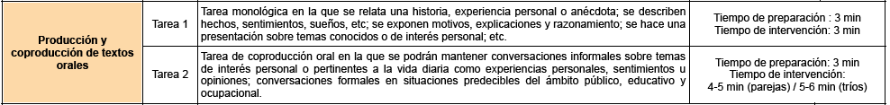
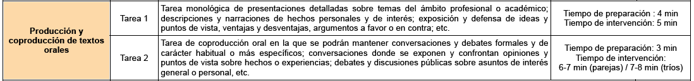

# 🗣️ PCTO - Speaking

| 🟢 B1 | 🔵 B2 |
|---|---|
|  |  |

## T1 Monólogo

Hablas tú solo sobre un tema de la tarjeta.

!!! success estructura "Estructura · monólogo"

    1. **Start** — saluda, di tu nombre y el tema.
    2. **Introduction** — engancha a quien te escucha: una pregunta retórica, un dato curioso o un hecho conocido.
    3. **Main points** — 2-3 puntos, cada uno con un ejemplo; preséntalos, enuméralos y pasa de uno a otro.
    4. **Your opinion** — di qué piensas (y, si puedes, con una opinión fuerte).
    5. **Conclusion** — resume, añade un último punto y cierra dando las gracias.

!!! quote frases "💬 Frases clave para memorizar"

    | Parte | Frases |
    |-------|--------|
    | **Start** | 1. **How to start:** *Good morning. My name is ___ and today I'm going to talk about ___.* |
    | **Introduction** | 1. **Rhetorical question:** *Are children and teenagers watching too much TV these days?*<br>2. **Interesting fact:** *Did you know that…?*<br>3. **Stating a fact:** *As everybody knows, …* |
    | **Main points** | 1. **Introducing a point:** *First of all, I would like to point out…*<br>2. **Enumerating points:** *In addition, … / Moreover, …*<br>3. **Moving to the next point:** *This leads directly to my next point.* |
    | **Your opinion** | 1. **Giving your opinion:** *As I see it, …*<br>2. **Giving your opinion:** *It seems to me that…*<br>3. **Giving a strong opinion:** *I strongly believe that…* |
    | **Conclusion** | 1. **Final points:** *Last but not least, …*<br>2. **Concluding:** *To sum up, …*<br>3. **Final sentence:** *And that is all I wanted to say about this topic. Thank you for listening.* |

!!! tip consejos "💡 5 consejos"

    1. **Lee bien las instrucciones** y toca todos los puntos de la tarjeta.
    2. **Notas con palabras clave, no frases:** apunta todas las ideas que puedas por si te bloqueas, y que se encuentren de un vistazo.
    3. **Si no sabes qué decir, invéntatelo:** no tiene que ser tu opinión real, y es más fácil hablar defendiendo una opinión fuerte.
    4. **No te repitas:** no abuses de *I think* / *In my opinion* (usa *In my view, I feel that, As far as I'm concerned*) y, para retomar algo, *As I mentioned earlier, …*
    5. **Controla el tiempo y olvídate del tribunal:** mira al examinador, no a las notas; también apuntan lo bueno que dices, no solo tus errores. Practica a menudo y grábate.

??? note "Si la tarea parte de una foto o un gráfico"

    1. **Describe lo que se ve, en general:** *The picture shows a group of people… In the foreground / background, there is…*
    2. **Da detalles concretos:** *On the left / right, I can see… What stands out to me is…*
    3. **Especula sobre lo que no se ve:** *It looks like they might be… / I imagine that…*
    4. **Relaciónalo con tu experiencia u opinión:** *This reminds me of… / Personally, I think this shows…*

    > **Error típico:** limitarse a listar objetos (*There is a table. There is a chair.*) sin conectar ideas ni interpretar.

??? note "Plantilla para los minutos de preparación"

    ```
    Tema: ___________
    Idea 1: ___________ (ejemplo: ___________)
    Idea 2: ___________ (ejemplo: ___________)
    Vocabulario que quiero usar: ___________
    Opinión fuerte: ___________
    Frase de cierre: ___________
    ```

## T2 Conversación

Conversas con otro candidato (o con el examinador). Se evalúa **mantener una conversación real**: escuchar, reaccionar y construir sobre lo que dice el otro, no soltar dos monólogos seguidos. **B1:** 3 min de preparación + 4-5 min (parejas) · **B2:** 3 min + 6-7 min.

!!! success estructura "Estructura · conversación"

    1. **Open** — lanza el tema y da tu primera opinión.
    2. **Ask** — pregunta qué opina tu compañero y cédele el turno.
    3. **React** — muestra acuerdo o desacuerdo con tacto, partiendo de lo que ha dicho.
    4. **Keep it going** — gana tiempo, pide aclaraciones o añade una idea nueva.
    5. **Close** — llegad a una conclusión o a un acuerdo si la tarea lo pide.

!!! quote frases "💬 Frases clave para memorizar"

    | Parte | Frases |
    |-------|--------|
    | **Open** | 1. **Giving your opinion:** *I'd say that…*<br>2. **Giving your opinion:** *In my view, …*<br>3. **Giving your opinion:** *From my point of view, …* |
    | **Ask** | 1. **Asking for an opinion:** *What do you think about…?*<br>2. **Asking for an opinion:** *How do you see it?*<br>3. **Asking for an opinion:** *Do you agree with me?* |
    | **React** | 1. **Agreeing:** *That's a fair point.*<br>2. **Agreeing:** *I couldn't agree more.*<br>3. **Disagreeing politely:** *I see your point, but…* |
    | **Keep it going** | 1. **Gaining time:** *Well, let me think…*<br>2. **Asking for clarification:** *Sorry, could you repeat that?*<br>3. **Interrupting politely:** *Sorry to interrupt, but…* |
    | **Close** | 1. **Reaching an agreement:** *So, shall we go for…?*<br>2. **Concluding:** *So, to sum up, …*<br>3. **Concluding:** *Overall, I think…* |

!!! tip consejos "💡 5 consejos"

    1. **Cede el turno de forma natural:** ni monopolices la conversación ni te quedes callado esperando.
    2. **Construye sobre lo que dice el otro** en lugar de seguir con lo que tenías preparado.
    3. **Nunca respondas con monosílabos** (*Yes / No / I don't know*): da siempre una razón o un ejemplo.
    4. **Discrepa sin miedo pero con tacto:** una opinión matizada en desacuerdo puntúa más que darle la razón en todo.
    5. **Llegad a una conclusión o acuerdo** si la tarea lo pide, manteniendo un tono colaborativo.

??? example "Ejemplo: Some people say working from home is better than working in an office. What's your opinion?"

    **Candidato:** Well, that's an interesting question. **(gana tiempo)** In my view, it really depends on the type of job. **(matiz inicial)** On the one hand, working from home gives you more flexibility and saves commuting time. On the other hand, I think face-to-face contact with colleagues is important for collaboration and creativity. **(argumento y contraargumento)**

    **Examinador:** Do you think this could change in the future?

    **Candidato:** That's a fair point. **(reacciona antes de responder)** I'd say hybrid models are probably the way forward, combining the best of both.


## Rúbricas (B1)

5 criterios, cada uno sobre **5 puntos**. Para la nota máxima:

| Criterio | Para sacar un 5 |
|---|---|
| **Competencia léxica** | Vocabulario amplio, sin repetir: reformula. |
| **Competencia gramatical** | Estructuras simples bien controladas y alguna compleja. |
| **Fonética y fluidez** | Pronunciación clara, ritmo natural y pocas pausas. |
| **Discursiva y organizativa** | Empieza, mantiene y cierra; ideas conectadas con conectores. |
| **Adecuación a la tarea** | Registro y cortesía adecuados; ideas con detalle y ejemplos. |

## Modismos

- I'd say that... (yo diría que...)
- To be honest... (siendo honesto...)
- As far as I know... (que yo sepa...)
- It seems to me that... (me parece que...)
- I'm not entirely sure, but... (no estoy del todo seguro, pero...)

## Bloques
- **"By the time I..."** → conecta dos momentos: algo ya estará hecho antes de otra cosa.
> "By the time I got home, my sister had already left." *Cuando llegué a casa, mi hermana ya habia salido*
- **"Even though..."** → contraste, "aunque algo sea así, pasa otra cosa".
> "Even though it was raining, we went for a walk."
- **"What I'm looking forward to is..."** → algo que esperas con ilusión (para el futuro, no para algo que ya pasó).
> "What I'm looking forward to is my trip next month." *Lo que más espero es mi viaje del mes que viene.*
  