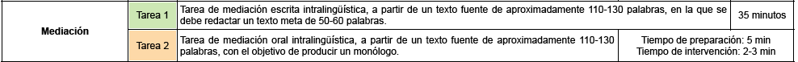
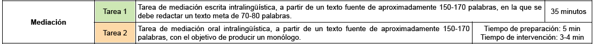

# 🤝 Mediación

## ✍️ Mediación escrita

La mediación evalúa la capacidad de **actuar como puente entre un texto (o una persona) y otra persona que no tiene acceso directo a ese texto o a ese idioma**. No es traducción literal palabra por palabra: es selección, síntesis y adaptación de la información relevante.

| 🟢 B1 | 🔵 B2 |
|---|---|
|  |  |

!!! success "Sinónimos para "subir de nivel" un texto"
      * good → **beneficial, advantageous, valuable, effective**
      * bad → **detrimental, harmful, problematic, counterproductive**
      * big → **significant, substantial, considerable**
      * important → **crucial, essential, fundamental, paramount**
      * a lot of → **numerous, a considerable number of, a wide range of**
      * think → **believe, argue, maintain, contend**
      * show → **demonstrate, reveal, indicate, highlight**
      * get → **obtain, acquire, achieve**

!!! success "Plantilla de planificación rápida (para usar en el examen)"
      ```
      Tipo de texto: ___________
      Destinatario/registro: ___________
      Puntos obligatorios a incluir: 1) ___ 2) ___ 3) ___
      Conectores que voy a usar: ___________
      Palabras objetivo: ___________
      ```

**EJEMPLOS**

!!! example "Mediación receptiva resuelta"
      **Tarea:** un compañero de trabajo, que no ha tenido tiempo de leer el correo, pregunta de qué trata un email largo sobre un cambio de horario de reuniones. Hay que explicárselo oralmente en inglés en 30 segundos.

      **Mal enfoque (traducción literal de todo):** repetir frase por frase todo el contenido del email, incluidas fórmulas de cortesía y detalles irrelevantes, sin priorizar.

      **Buen enfoque (mediación real):** *"Basically, the Monday meeting has been moved to 10am instead of 9am, starting next week. Everything else stays the same."* — se selecciona solo la información accionable, se ignoran los saludos y las fórmulas de cortesía del email original, y se adapta a un registro oral breve y directo.

### Consejos
!!! note "CONSEJOS"
    1. **Planificar** 3-5 minutos antes de escribir, siempre.
    2. **Adecuación:** Responder a todos los puntos del enunciado, con el formato y el registro correctos 
    3. **Identificar qué información es relevante** para la persona destinataria del mensaje
    4. **Adaptación de registro:** si el destinatario es un amigo, tono cercano; si es un informe para un superior, tono formal.
    5. **Coherencia y cohesión:** ¿las ideas están bien organizadas en párrafos, con conectores variados?
    6. **Corrección gramatical:** ¿hay errores sistemáticos (no puntuales) que afecten a la comprensión?
    7. **Riqueza léxica y registro:** ¿el vocabulario es variado y el tono es coherente con la tarea?
    8. **Selección:** incluir solo la información relevante para la tarea, no todo el texto original.
    9. **Reformulación:** usar palabras propias, no copiar frases enteras del texto origen y controlar la extensión (±10% del rango pedido) y dejar tiempo para revisar.
   
!!! failure "ERRORES"
      1. **Traducir literalmente en vez de reformular.** La mediación no pide una traducción palabra por palabra, sino transmitir el sentido con las propias palabras.
      2. **Incluir toda la información del texto original**, incluso lo irrelevante para la tarea concreta, en lugar de seleccionar lo importante.
      3. **Olvidar el destinatario.** El registro y el nivel de detalle deben adaptarse a quién va a recibir la información (un amigo, un cliente, un compañero de trabajo).
      4. **No adaptar el formato pedido** (si se pide una nota breve y se entrega un párrafo largo, o al revés).


## Claude reading

Esta parte claude me pregunta sobre pequeños texto y respondo con otro tipo de texto para que en la mediación no se me ocuura copiar y pegar el texto que estoy leyendo.

Trucos concretos que funcionan:

1. **No traduzcas mentalmente el texto entero**. Lee buscando la idea general primero (skim), y solo cuando ya sabes qué pregunta cada número, vuelve al texto a buscar esa frase concreta (scan).
2. **Las preguntas suelen seguir el mismo orden que el texto**. Si la pregunta 16 es sobre el principio, la 17 normalmente está más adelante en el mismo párrafo o el siguiente — no busques por todo el texto sin orden.
3. **Responde con tus propias palabras, no copies la frase del texto tal cual**. Si el texto dice "researchers warn that X may be replacing Y", no repitas eso literal — reformúlalo: "Some experts are concerned that X could be taking over from Y." Esto te obliga a demostrar que entendiste, no que memorizaste, y es justo lo que piden en el examen real.


